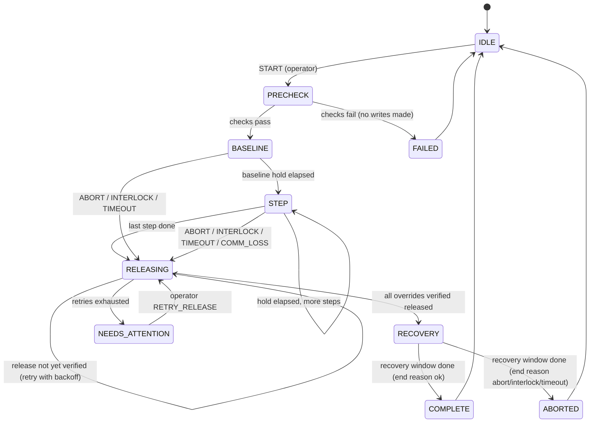

# Design: NF HVAC functional test app

Status: draft for v0.1. Audience: the engineer or agent building the app.

## 1. Purpose and scope

Automate the functional-test portion of a retro-commissioning visit for VAV air handling units, and capture clean data while it runs.

In scope:

- AHU test sequence with overrides, hold timers and release (section 3).
- Optional VAV max-cooling-airflow step (section 4).
- Higher-rate data capture tagged with run and step IDs (section 6).
- Safety: dry-run, priority-array discipline, release on every exit path (section 7).
- A Normal Framework (NF) app: Node.js hooks, an operator API and a small status page (section 8).

Out of scope: fault detection and analytics (SQL or any FDD engine consumes the data later), root-cause diagnosis, equipment modeling, plant-level tests, and any write to a site without explicit operator approval.

### Why functional testing helps FDD

Fault rules need the equipment in known states. Running an AHU in full recirculation with coils off makes mixed, return and supply air temperatures converge (supply rises a little from fan heat), so stuck or leaking dampers, leaking valves and biased sensors show up cleanly. A 100% outside-air step in good economizer weather does the same for economizer logic. Capturing 1-minute or faster data during these windows gives rules clean, labeled input. Running the test on a schedule (for example weekly, off-peak, with maintenance staff nearby) turns commissioning into recurring data quality assurance.

Reference sequence (adapted from a published article on automated supervisory control and FDD):

1. Notify occupants of possible small temperature deviations.
2. Full recirculation about 20 minutes: OA damper closed, heating and cooling valves closed, fan running. Temperatures should equalize.
3. Compare supply, mixed and return sensors with each other (and optionally with a calibrated reference instrument, a manual step outside this app).
4. Further steps once recirculation is done: shut down and confirm motors stop, check minimum VFD speed, exercise dampers, test valves, restart and confirm duct static control.
5. In spring or fall with free-cooling weather, repeat with 100% outside air for about 20 minutes.

v0.1 implements steps 2 and 5 (plus baseline and recovery). Step 4 items are defined in the step catalog as later work (section 3.4).

## 2. Concepts and terms

- **Run**: one execution of a test plan on one AHU (and optionally its VAV boxes). Has a `run_id` (ULID) and a numeric `run_seq` (monotonic counter).
- **Step**: a named phase with fixed overrides and a hold time. Has a stable `step_id` such as `ahu.recirc` and a numeric `step_index` within the run.
- **Override**: a write by this app to a commandable point, always recorded in the ledger before it is sent.
- **Role**: a point's meaning on a piece of equipment, named in 223P-derived snake_case (section 5.1). Configuration maps roles to NF point UUIDs.
- **Ledger**: the persistent record of every override and every changed trend period, used for release and crash recovery.
- **Tick**: one invocation of the engine hook (every 10 s). All progress is persisted, so a restart is just a gap in ticks.

## 3. AHU test sequence

### 3.1 State machine



Rules:

- The transition function is pure: `next(state, event) -> { state, effects[] }`. Effects (write, release, sample, notify) are executed by a separate runner, so the machine is unit-testable with no I/O.
- Events: `START`, `TICK(now)`, `ABORT(reason)`, `INTERLOCK(code)`, `TIMEOUT`, `COMM_LOSS`, `WRITE_FAILED(point)`, `RELEASE_RESULT(ok|fail)`, `RETRY_RELEASE`.
- Every non-happy event from BASELINE or STEP goes to RELEASING. There is no path that leaves a step without passing through RELEASING.
- RELEASING is only left when a read of each written point confirms our priority slot is empty (section 7.4) or the command context has ended.
- `NEEDS_ATTENTION` is sticky across restarts. The app refuses to start another run until an operator retries release or acknowledges.
- One active run per AHU. Default `max_concurrent_runs` is 1 per site.

### 3.2 Steps (v0.1)

All hold times are configurable. Defaults below. "Settle" is the time at the start of each step that analysts should exclude; it is recorded in the manifest and not enforced.

| step_id | Purpose | Overrides (roles written) | Default hold | Settle |
| --- | --- | --- | --- | --- |
| `ahu.baseline` | Normal operation reference | none | 5 min | 0 |
| `ahu.recirc` | Full recirculation, coils off | `outdoor_air_intake_damper_position_command` = 0 %, `return_damper_position_command` = 100 % (if bound), `cooling_valve_position_command` = 0 %, `heating_valve_position_command` = 0 %. Supply fan is not written; it must already be running. | 20 min | 5 min |
| `ahu.economizer` (conditional) | 100% outside air, coils off | `outdoor_air_intake_damper_position_command` = 100 %, `return_damper_position_command` = 0 % (if bound), `cooling_valve_position_command` = 0 %, `heating_valve_position_command` = 0 % | 20 min | 5 min |
| `vav.max_cool` (optional, section 4) | VAV boxes at max cooling airflow with the AHU held in `ahu.recirc` or `ahu.economizer` | AHU overrides carry over; VAV overrides per strategy | 30 min | 5 min |
| `recovery` | Overrides released, monitoring continues | none | 10 min | 0 |

Alternative AHU strategy `mode_point`: if the BAS exposes one commandable enumerated or binary point that puts the unit in a test mode (for example "recirculation test"), config maps `test_operating_mode_command` and the value per step. The app then writes that one point instead of the individual roles. This is the preferred strategy when available because BAS logic keeps its own protections active.

`ahu.economizer` runs only when all conditions hold at PRECHECK and again at the start of the step: `outdoor_air_intake_temperature` within `econ_window` (default 10 to 18 degC), `return_air_temperature - outdoor_air_intake_temperature >= econ_min_delta_k` (default 3 K), `outdoor_air_intake_relative_humidity <= econ_max_rh` (default 70 %, skipped if the role is unbound), and no freeze interlock active. Otherwise the step is skipped and the skip reason is recorded. When the weather is outside the window (peak heat or cold), the run uses recirculation only.

### 3.3 Step order

Default plan: `baseline`, `recirc`, `economizer` (if eligible), `vav.max_cool` (if enabled), `recovery`. The plan is an ordered list in config, so a site can disable or reorder steps. `vav.max_cool` must follow an AHU test step because the AHU must already be in its test state.

### 3.4 Step catalog for later versions

Defined now so the state machine and config do not change shape later:

- `ahu.fan_off`: command fan off, confirm status goes off (motor stops), restore.
- `ahu.fan_min_speed`: ramp to the minimum VFD speed, record.
- `ahu.damper_stroke`: stroke OA and return dampers 0/50/100 % with hold at each, record position feedback.
- `ahu.valve_stroke`: stroke heating and cooling valves with hold, record position and leaving temperatures.
- `ahu.startup_static`: restart and confirm duct static control to setpoint.
- `ahu.economizer_mech`: economizer plus mechanical cooling.
- Scheduling (for example weekly at a set time) and sequential VAV waves.

Each is a step definition: `{ step_id, overrides, hold_s, settle_s, preconditions[], interlocks[] }`.

### 3.5 Preconditions (PRECHECK, read-only)

PRECHECK performs no writes. It fails the run if any of these fail:

1. Config validates against the JSON Schema and every role used by the plan is bound to an NF point that exists.
2. Capability detection (section 4.2 for VAV, 3.6 for AHU) finds every AHU role the plan writes commandable. Missing optional roles are reported, missing required roles fail.
3. `supply_fan_operating_status` is on (when bound) and has been for at least 5 min.
4. All involved sensors have a reading newer than `max_sample_age_s` (default 120 s) and within plausible bounds.
5. No higher-priority override (lower slot number than ours) is active on any point we will write. Existing overrides at our own priority, from an unknown writer, also fail the run.
6. No active interlock condition (section 7.5).
7. Run window rules: optional `allowed_windows` (day of week plus local time ranges) when configured.
8. No other run is active or in `NEEDS_ATTENTION`.
9. Dry-run flag and operator `confirm_live` agree (section 7.2).

### 3.6 AHU capability detection

For each AHU role the plan will write:

1. The role is bound in config and `writable: true` is set for it (explicit allow-list).
2. The NF point exists and its layer supports writes (BACnet, `hpl:bacnet:*`).
3. The object has a readable `PRIORITY_ARRAY` (commandable). If not, it is not writable by this app.
4. No slot with number less than ours holds a value, and our slot is empty (or already ours per the ledger).
5. NF write guardrails (site policy) accept the target value. A guardrail reject at the first write is treated as capability failure for that point.

Failure of a required AHU role fails PRECHECK. Failure of an optional role (for example `return_damper_position_command`) is reported and the step proceeds without it.

## 4. Optional VAV max-cooling-airflow step

Purpose: hold every VAV box at maximum cooling airflow so airflow, damper position, duct static and discharge conditions can be captured with the AHU in a known test state. Some control systems cannot write box airflow setpoints, so there are three strategies and a capability report.

### 4.1 AHU state during the step

`vav_test.ahu_mode`: `auto` (default), `recirc` or `economizer`. In `auto`, use `economizer` if the section 3.2 economizer conditions hold, otherwise `recirc`. The AHU overrides for the chosen mode stay applied for the whole VAV hold. The AHU's own duct static and supply temperature control loops remain in the BAS, so the fan ramps to meet the demand.

### 4.2 Strategies

| Strategy | `vav_test.strategy` | What is written | Capability check |
| --- | --- | --- | --- |
| a | `bas_toggle` | One system-level point `maximum_cooling_operating_mode_command` (binary or enumerated value from config). BAS programming applies max cooling to the boxes. | Point bound, `writable`, commandable. After the write, at least `bas_toggle_min_boxes_responding_pct` (default 60 %) of bound boxes show `discharge_air_volume_flow_rate` rising toward their maximum, or the strategy is reported as `no_effect` and the step ends early. |
| b | `flush_point` | Per box `purge_operating_mode_command` = on (value from config). | Per box: role bound, commandable. Boxes without it are skipped and listed. |
| c | `airflow_setpoint` | Per box `discharge_air_volume_flow_rate_setpoint` = the box's `discharge_air_volume_flow_rate_maximum` (read from the controller). If the maximum is not readable, an explicit per-box or default value from config is used. | Per box: setpoint role bound, commandable (priority array present), maximum readable or configured. After the write, readback of the setpoint equals the target within tolerance within `verify_s` (default 30 s), otherwise the controller overwrote or ignored it and the box is `write_not_effective`. |

`vav_test.strategy` can also be `auto`: try `bas_toggle` if bound, else `flush_point` if any box has it, else `airflow_setpoint`. Mixed fleets are supported: a `per_box_strategy` order (default `["flush_point", "airflow_setpoint"]`) picks the first strategy a box supports when the strategy is `auto_per_box`.

### 4.3 Capability report

PRECHECK for the VAV step produces a per-box result and a summary, stored in the manifest and shown in the UI:

```json
{
  "strategy": "airflow_setpoint",
  "boxes_total": 42,
  "boxes_capable": 36,
  "boxes_skipped": [
    { "equipment_id": "vav_17", "reason": "no_priority_array" },
    { "equipment_id": "vav_21", "reason": "role_unbound:discharge_air_volume_flow_rate_setpoint" },
    { "equipment_id": "vav_30", "reason": "higher_priority_override_active" },
    { "equipment_id": "vav_33", "reason": "device_offline" }
  ],
  "write_not_effective": []
}
```

If `boxes_capable` is below `vav_test.min_capable_boxes` (default 1), the VAV step is skipped with reason `insufficient_capability` and the run continues to recovery.

### 4.4 Limits and pacing

- `max_boxes_overridden` (default 25): upper bound on simultaneously overridden boxes. Extra boxes are skipped and reported (`over_box_limit`).
- `batch_size` (default 5) and `batch_delay_s` (default 20): boxes are written, and later released, in batches so duct static and fan speed do not step all at once.
- `hold_minutes` (default 30, minimum 5, maximum 120): the hold starts after the last batch is verified.
- Per-write value clamps: airflow setpoint never above the box's configured maximum, never above `airflow_setpoint_hard_cap_m3s` when set.
- Interlocks (section 7.5) are evaluated each tick; a trip releases VAVs first (in batches), then the AHU.

### 4.5 Release order

VAV overrides are released first (in batches), then AHU overrides, then trend periods are restored (section 6.3). Release is verified per point.

## 5. Configuration

### 5.1 Roles (223P-derived snake_case, SI on the wire)

Roles follow the Open-FDD convention (open-fdd issue 1804): 223P-derived snake_case, SI units, no acronyms. Roles already in that convention are used as is. Roles marked `ftest` are proposed for this app and should be contributed to the shared role registry. A parity check against the Open-FDD role list is added once Open-FDD 5.0.22 is tagged.

AHU roles:

| Role | Direction | SI unit | Required |
| --- | --- | --- | --- |
| `discharge_air_temperature` | read | degC | yes |
| `mixed_air_temperature` | read | degC | yes |
| `return_air_temperature` | read | degC | yes |
| `outdoor_air_intake_temperature` | read | degC | yes |
| `outdoor_air_intake_relative_humidity` | read | % | no |
| `discharge_air_temperature_setpoint` | read | degC | no |
| `discharge_air_static_pressure` | read | Pa | yes (interlock) |
| `discharge_air_static_pressure_setpoint` | read | Pa | no |
| `supply_fan_operating_status` | read | bool | yes |
| `supply_fan_command` | read | bool or % | no (not written by default) |
| `outdoor_air_intake_damper_position` | read | % | no |
| `return_damper_position` | read | % | no |
| `cooling_valve_position` | read | % | no |
| `heating_valve_position` | read | % | no |
| `outdoor_air_intake_damper_position_command` (`ftest`) | write | % | per strategy |
| `return_damper_position_command` (`ftest`) | write | % | no |
| `cooling_valve_position_command` (`ftest`) | write | % | per strategy |
| `heating_valve_position_command` (`ftest`) | write | % | per strategy |
| `test_operating_mode_command` (`ftest`) | write | enum | `mode_point` only |
| `air_temperature_low_limit_alarm_status` (`ftest`) | read | bool | recommended (interlock) |
| `air_smoke_alarm_status` (`ftest`) | read | bool | recommended (interlock) |
| `maximum_cooling_operating_mode_command` (`ftest`) | write | bool or enum | `bas_toggle` only |

VAV box roles:

| Role | Direction | SI unit |
| --- | --- | --- |
| `discharge_air_volume_flow_rate` | read | m3/s |
| `discharge_air_volume_flow_rate_setpoint` | read/write | m3/s |
| `discharge_air_volume_flow_rate_maximum` (`ftest`) | read | m3/s |
| `damper_position` | read | % |
| `zone_air_temperature` | read | degC |
| `zone_air_temperature_setpoint` | read | degC |
| `purge_operating_mode_command` (`ftest`) | write | bool or enum |

Units: the app reads each point's NF `units` and converts to SI for thresholds and logging. A point with an unknown or unconvertible unit is reported and excluded from interlocks that depend on it; if it is a required interlock input the run fails PRECHECK. Imperial values are display-only in the UI.

### 5.2 Site config

Stored as the NF app option `siteConfig` (a JSON string; NF app options arrive as strings, so the app `JSON.parse`s it), validated against `schema/site-config.schema.json`. Config contains NF point UUIDs and generic equipment IDs only. The repository contains synthetic examples only.

```jsonc
{
  "version": 1,
  "dry_run": true,                         // default true; see 7.2
  "write": {
    "backend": "nf_command",               // "nf_command" (default) or "bacnet_direct"
    "bacnet_priority": 8,                  // 3..16; 1 and 2 are always rejected
    "command_lease_s": 300,                // NF command context lifetime
    "keepalive_s": 60,                     // extend the lease at this interval
    "verify_s": 30,                        // readback window after a write
    "release_retries": 6,
    "release_backoff_s": [5, 10, 20, 40, 60, 120]
  },
  "limits": {
    "max_total_minutes": 150,              // hard cap per run, then release
    "max_tick_gap_s": 60,                  // longer gap: treat as comm loss, release
    "max_comm_failures": 3,                // consecutive failed ticks
    "max_boxes_overridden": 25
  },
  "interlocks": {
    "duct_static_pressure_max_pa": 1000,   // abort above this
    "mixed_air_temperature_min_c": 7,      // abort below this (freeze risk), all steps with OA open
    "discharge_air_temperature_min_c": 5,
    "zone_air_temperature_min_c": 18,      // abort if median zone temp leaves this band
    "zone_air_temperature_max_c": 27,
    "fan_status_loss_abort": true,
    "freeze_protection_status_abort": true,
    "smoke_alarm_status_abort": true
  },
  "logging": {
    "mode": "shadow",                      // "shadow" (default), "period_boost", "both"
    "sample_interval_s": 20,               // multiple of the tick (10 s); minimum 10
    "boost_period_s": 30,                  // period_boost only; minimum 15
    "max_boosted_points": 60,
    "recovery_minutes": 10
  },
  "plan": {
    "steps": [
      { "step_id": "ahu.baseline", "hold_minutes": 5 },
      { "step_id": "ahu.recirc", "hold_minutes": 20, "settle_minutes": 5 },
      { "step_id": "ahu.economizer", "hold_minutes": 20, "settle_minutes": 5, "conditional": "econ_window" },
      { "step_id": "vav.max_cool", "enabled": false, "hold_minutes": 30, "settle_minutes": 5 },
      { "step_id": "recovery", "hold_minutes": 10 }
    ],
    "econ_window": { "low_c": 10, "high_c": 18, "min_delta_k": 3, "max_rh_pct": 70 },
    "ahu_strategy": "per_point",           // or "mode_point"
    "mode_point_values": { "ahu.recirc": 1, "ahu.economizer": 2 }
  },
  "vav_test": {
    "strategy": "airflow_setpoint",        // bas_toggle | flush_point | airflow_setpoint | auto | auto_per_box
    "ahu_mode": "auto",                    // auto | recirc | economizer
    "batch_size": 5,
    "batch_delay_s": 20,
    "min_capable_boxes": 1,
    "values": { "bas_toggle_on": 1, "flush_on": 1 },
    "airflow_setpoint_default_m3s": null
  },
  "equipment": [
    {
      "id": "ahu_a",
      "type": "ahu",
      "points": {
        "discharge_air_temperature": { "uuid": "…", "layer": "hpl:bacnet:1" },
        "outdoor_air_intake_damper_position_command": { "uuid": "…", "layer": "hpl:bacnet:1", "writable": true }
      },
      "serves": ["vav_01", "vav_02"]
    },
    {
      "id": "vav_01",
      "type": "vav",
      "points": {
        "discharge_air_volume_flow_rate": { "uuid": "…", "layer": "hpl:bacnet:1" },
        "discharge_air_volume_flow_rate_setpoint": { "uuid": "…", "layer": "hpl:bacnet:1", "writable": true }
      }
    }
  ]
}
```

Point binding options, in order of precedence per role: the data model (section 5.3); else an explicit `uuid`; else a Haystack/NF query (`{ "equip_ref": "...", "markers": [...] }`) resolved at PRECHECK to exactly one point (zero or several is a PRECHECK failure, never a guess). `serves` may instead be resolved from `airRef`/`equipRef` relationships when the model has them. A read-only `config discover` operator action proposes a role map from the NF model for review but never saves or writes anything by itself.

### 5.3 Data-model-driven planning

The test plan is not hard-coded per site or per box. `lib/plan.js` is a pure function: internal model plus site policy in, ordered steps and a capability report out. The same planner run on a different model produces a different plan.

Two adapters build the same internal model:

- Haystack tags are the primary input. NF points are read as tag sets and layers. Tags come from a `tags` array, marker values on `attrs` (`m:`, `M`, `marker`, or `true`), and from the `class` and comma-separated `markers` attributes. `equipRef` / `ahuRef` attach the point. `schema/haystack-role-map.json` (version field) maps a tag set to one 223P-derived role. Tag names follow Haystack 4 (`cool` / `heat`, `freezeStat`, `ductStatic`, damper tags without an extra `air` marker). The longest matching tag set wins. A `cmd` marker keeps only roles whose tag set includes `cmd`. If two roles still tie, the point gets no role and is listed on `ambiguous`. Forbidden markers are per role (`max` and `min` on setpoint roles). A site may overlay that file; no code change is required to add a tag set. Role names live only in `lib/roles.js` and this map.
- RDF/223P is not an input in this build. `loadRdfModel` throws `RdfInputDisabledError` (`rdf_input_disabled`) and does not parse Turtle. The hand-written splitter dropped namespaces, kept local names, under-counted triples, and threw on a real 223P export. `schema/rdf-role-map.json` is gone. Those type names were not 223P or Brick terms, and a shared local name such as `brick:Sensor` and `urn:local:Sensor` must not bind the same role. `matchRoleIri` keeps a role only when exactly one full IRI hits the role table. Haystack remains the path that builds a plan.

Writable versus read-only is a model fact, not a per-box branch. A point is model-writable only when it carries a `writable` marker (a `cmd` or `sp` tag alone is not enough). The role registry still has to allow writes. An explicit config binding must also set `writable: true`; that flag cannot promote a point the model marks read-only. If the model says writable and a later priority-array or readback probe disagrees, the point is skipped with `no_priority_array` or `write_not_effective` and is not written.

Planning rules, applied uniformly:

- `ahu.recirc` runs when the coil commands the strategy needs are model-writable. The outside-air damper command is included when it is model-writable and is not required for recirculation.
- `ahu.economizer` runs only when that damper command is model-writable (and the coil commands are). Otherwise the step is skipped with `economizer_points_missing`. Weather eligibility is still checked at runtime.
- Each VAV box gets the first strategy in the configured order that its own points support: `flush_point`, `airflow_setpoint`, or the AHU-level `bas_toggle`. A box with no model-writable strategy is skipped with `model_not_writable` or `role_unbound`. If fewer than `min_capable_boxes` qualify, `vav.max_cool` is skipped with `insufficient_capability`.
- An interlock is active only when its input point is bound. Sample points are the bound points on the selected AHU and the boxes it serves.

Example tag sets in the shipped Haystack map: `discharge air temp sensor` maps to `discharge_air_temperature`; `air flow sp` plus the `writable` marker maps to `discharge_air_volume_flow_rate_setpoint` with writable true; `air flow max` maps to read-only `discharge_air_volume_flow_rate_maximum`. A point tagged `max` or `min` does not bind to that setpoint. `cool valve cmd` maps to `cooling_valve_position_command`. The airflow setpoint is the point the airflow strategy writes. The maximum is the cap that strategy reads.

RDF stays off the box until two artifacts exist: vendored Oxigraph 0.5.13 (Node build only, the same files as the upstream NF app) and the shared 223P role file plus a precomputed binding. The pin is `schema/shared-role-file.pin.json`. Its role-file sha256 is null while the file is absent. A file at `vendor/roles/shared-223p-roles.ttl` whose sha256 differs from the pin fails the check. The 223P ontology pin is sha256 `08f80bd6e15052f28cdfd354bdf46ff96e5e1afdba36a4dbed5186fc1ea51c41`. QUDT is 3.4.0 via imports. OntoEnv 0.6.4 and Shifty 0.6.0 do not run inside an NF hook: there is no Python on the box, Shifty's WebAssembly build is not a pinned package, and the hook must not fetch an ontology. Validation of example models is a CI job (`rdflib==7.6.0`, `ontoenv==0.6.4`, `pyshifty==0.6.0`) that fails on any Violation. That job is specified in `docs/superpowers/plans/2026-11-26-rdf-alignment.md` and is not enabled until the shared role file and the review that names it have landed. The follow-up also loads the upstream export fixture and requires 122 triples from Oxigraph, and loads the 223P snapshot export without error.

Validation rules (enforced in code and tests): hard-coded identifiers are not allowed in the app source; `bacnet_priority` is an integer 3 to 16; writes require the point flag `writable: true`; every write role must map to a role in the role registry; all thresholds in SI.

## 6. Data logging during the test window

### 6.1 What NF offers

- NF stores trends per point, driven by the point's `period` (and optional COV). BACnet points are polled by NF's poll service. Changing a period is a point-configuration change, not a BACnet write.
- Hooks can run on an RRULE schedule down to seconds (`FREQ=SECONDLY`), so a 10 s tick is practical. Hook runs have an invoke timeout, so long loops are not used.
- Apps can create their own layer and points and push values with the data API (`AddData`) with explicit timestamps.
- The command service can read live values from devices (`/api/v2/command/read`) and does not require a running command for reads.

### 6.2 Default: shadow sampling (`logging.mode = shadow`)

- At the start of PRECHECK the app creates (or reuses) one shadow point per involved source point in app layer `ftest`, UUID = uuidv5(source uuid, `ftest`). Attributes: `source_uuid`, `role`, `equipment_id`, `units`.
- Every `sample_interval_s` (default 20 s, minimum 10 s) the engine reads all involved points (live read via the command service, one batched request) and pushes the values as one `AddData` batch, with the device-read timestamp where available, else the tick time.
- Also pushed on each sample: `ftest_run_seq` (the numeric run counter) and `ftest_step_index` (the numeric step index; 0 = outside any step). These two points make the data joinable to the run manifest by timestamp with a trivial SQL range or as-of join, with no knowledge of the app.
- Sampling begins at PRECHECK completion (so baseline is covered) and runs through `recovery`.
- Advantages: does not touch production trend settings, no extra risk if the app dies, no change to existing Open-FDD or SQL trends. Disadvantage: analysis reads the `ftest` layer series.

### 6.3 Optional: period boost (`logging.mode = period_boost` or `both`)

For sites that want the data in the existing trend series: the app lowers `period` on the involved points that are already trended (never below `boost_period_s`, minimum 15 s, never more than `max_boosted_points`), records the original period in the ledger before changing it, and restores it at the end of RECOVERY and on every release path. This mode is marked experimental in v0.1: the partial-update semantics of the NF point update API must be verified against a lab NF before enabling (open question 1), and BACnet traffic on MS/TP routers must be budgeted (the app logs an estimated reads-per-second figure and refuses boosts above `max_reads_per_s`).

### 6.4 Run manifest

Written to `local/runs/<run_id>.json` (and returned by the operator API) during and after the run:

```jsonc
{
  "run_id": "01J…", "run_seq": 17, "plugin_version": "0.1.0", "dry_run": false,
  "equipment_id": "ahu_a", "started_at": "2026-11-26T18:00:00Z", "ended_at": "…",
  "end_reason": "complete",            // complete | abort | interlock:<code> | timeout | comm_loss | failed
  "config_hash": "sha256:…",           // of the validated config, no secrets
  "roles": { "discharge_air_temperature": "<point uuid>", "…": "…" },
  "capability": { "ahu": { … }, "vav": { … } },
  "steps": [
    { "step_id": "ahu.recirc", "step_index": 2,
      "started_at": "…", "analysis_from": "…", "ended_at": "…",
      "status": "done",                // done | skipped | aborted
      "skip_reason": null,
      "overrides": [ { "role": "outdoor_air_intake_damper_position_command", "value": 0, "priority": 8 } ] }
  ],
  "overrides": [ { "point": "<uuid>", "value": 0, "priority": 8, "written_at": "…", "released_at": "…", "release_verified": true } ],
  "interlock_events": [],
  "sampling": { "mode": "shadow", "interval_s": 20, "samples": 412, "gaps": [] },
  "release": { "all_verified": true, "retries": 0 }
}
```

All timestamps are UTC ISO-8601. `analysis_from` = step start + settle. A reference SQL example in `docs/sql-examples.md` (v0.1 deliverable) shows how to label a trend table using the step windows.

## 7. Safety and release design

Principle: no code path may end a run, crash or restart while a point is still overridden by this app, and if the app disappears entirely, NF reverts the writes on its own.

### 7.1 Defense in depth

| Layer | Mechanism | Covers |
| --- | --- | --- |
| 1 | NF command context with a short lease (`command_lease_s`, default 300 s) extended every `keepalive_s` | App crash, host loss of the app only, hook runtime death, stuck run. NF reverts at expiry. (If NF itself or its link to BACnet is down, expiry cannot occur until it is restored; this is an NF limit and is documented.) |
| 2 | Write-ahead ledger on disk | Restart recovery, `bacnet_direct` backend, audit |
| 3 | Engine tick watchdog: `max_tick_gap_s`, `max_comm_failures` | Hung or starved engine; detected on the next tick, which releases |
| 4 | Hard run cap `max_total_minutes` | Any logic bug that never ends a step |
| 5 | Interlocks (7.5) | Equipment and comfort limits |
| 6 | NF write guardrails (site policy), documented as a recommended setup | Wrong value or wrong point written by anything |
| 7 | Dry-run default and explicit live confirmation | Accidental live run |

### 7.2 Dry-run default and live confirmation

- `dry_run` defaults to `true`. In dry-run the full pipeline runs: config validation, point resolution, capability detection (reads only), planning, step timing, sampling, manifest. Every write is replaced by a ledger-style log entry `would_write` and a manifest override entry with `dry_run: true`. A test asserts zero write calls reach the NF client in dry-run.
- `dry_run_time_scale` (default 1, max 60) can compress hold timers in dry-run only, so the sequence can be rehearsed quickly. It is ignored when `dry_run` is false.
- Going live needs both `dry_run: false` in config and `confirm_live: true` in the operator START request for that run. Neither alone enables writes.

### 7.3 Writes

- Backend `nf_command` (default): each run creates one command context per equipment named `ftest-<run_id>-<equipment_id>` (NF refuses a duplicate name, which also acts as a lock). Writes use `/api/v2/command/write` with a per-write BACnet priority from `write.bacnet_priority` (via the write command options, `BACnetCommandOptions.priority`; verify the JSON path on a lab NF, open question 2). `cancel_on_conflict` is set so a point already written at the same system priority makes the write fail rather than stack. NF reverts the point when the context ends (priority array slot cleared).
- Backend `bacnet_direct` (fallback for NF versions or sites without the command path): BACnet WriteProperty to `PRESENT_VALUE` at `bacnet_priority`; release is a write of NULL at the same priority. There is no automatic expiry in this mode, so layers 2 to 4 carry the safety load. The UI and manifest mark it `no_auto_expiry`.
- Priority rules: integer 3 to 16, default 8. Priorities 1 and 2 are rejected at config validation and at write time, no override flag. Priority 8 (manual operator) leaves 1 to 7 free for life-safety and critical logic.
- A write is only sent for a role that is in the plan's write set, has `writable: true`, passed capability detection, and whose value is inside the role's clamp (percent 0 to 100, airflow within configured caps, enum values from config).
- The supply fan command is not in the default write set. The fan is never commanded off by v0.1 steps.
- Order of operations for every write: (1) append `intent` to the ledger and fsync, (2) send, (3) append `active` or `failed`. A crash between 1 and 3 leaves an `intent` entry, which recovery treats as possibly written and releases.

### 7.4 Release

Release is idempotent and verified.

- Triggers: step plan completed, operator ABORT, TIMEOUT, interlock trip, comm loss or tick gap, any unhandled exception in the runner, plugin shutdown signal (best effort), and plugin start (recovery).
- Procedure: release VAV overrides in batches, then AHU overrides. For `nf_command` this is `CancelCommand` (reverts everything in the context) followed by per-point verification. For `bacnet_direct` it is NULL at our priority.
- Verification: read `PRIORITY_ARRAY` for each written point. Our slot must be empty (NULL). For points without a priority array, the present value must not equal the overridden value or the prior value is written back (the command service handles this; the direct backend does not support non-commandable points and never writes them).
- Failures retry with the configured backoff. When retries are exhausted the state is `NEEDS_ATTENTION`: the ledger keeps the entries open, NF variable `ftest_needs_attention` is set to 1 (so a site alarm or Open-FDD can see it), and the UI shows the unreleased points with a manual instruction. The app keeps retrying at a low rate (every 5 min) until released or acknowledged.
- NF zombie writes (reversions NF could not deliver because a device was offline) are read via the zombie API each tick during RELEASING and reported; they are retried by NF.

### 7.5 Interlocks (evaluated each tick, any step)

Any of these ends the run via RELEASING with reason `interlock:<code>`:

- `duct_static_high`: `discharge_air_static_pressure` above `duct_static_pressure_max_pa`.
- `mixed_air_low`: `mixed_air_temperature` below `mixed_air_temperature_min_c` while the OA damper command is above 0 (freeze risk).
- `discharge_air_low`: `discharge_air_temperature` below the limit.
- `fan_status_lost`: `supply_fan_operating_status` off during a step.
- `freeze_protection`: `air_temperature_low_limit_alarm_status` true.
- `smoke_alarm`: `air_smoke_alarm_status` true.
- `zone_out_of_band`: median `zone_air_temperature` of the served boxes outside the band for more than 5 min.
- `stale_data`: a required interlock input older than `max_sample_age_s` for two consecutive samples.
- `override_conflict`: a point we wrote now shows a different value or a lower-numbered slot written by another writer (an operator took over); the app releases its own writes and stops without fighting.

### 7.6 Operator control

- Operator actions: `start` (requires equipment id, optional plan overrides, `confirm_live`), `abort` (immediate RELEASING), `status`, `retry_release`, `acknowledge`, `config validate`, `config discover` (read-only).
- Access goes through NF's authenticated app/hook API (console login or API key). The app records the caller identity NF provides, where available, and the free-text reason in the manifest.
- Scheduled and unattended runs are not in v0.1. When added: off by default, need `allow_unattended: true` and `allowed_windows`, and still respect all gates above.
- The status page shows run state, current step, time left, overrides active, interlock readings, release status, and the VAV capability report. Abort is one click and needs no confirmation.

### 7.7 Restart recovery

On engine start (and on every tick before any other work):

1. Load the ledger. Any entry not `released` triggers RELEASING for its run before anything else, using the ledger's backend and priority, even if the config has since changed.
2. Query NF for active commands named `ftest-*` and cancel any that are not in an active run (covers a lost ledger file).
3. Restore any trend periods recorded in the ledger as changed.
4. Compare the tick gap against `max_tick_gap_s`. A run resuming after a larger gap is aborted and released, not resumed.
5. Report orphans: points holding our configured priority slot with no ledger entry are reported, never written to.

The ledger is JSON Lines under `local/` (untracked, survives app upgrades), written with fsync, with a periodic snapshot using write-to-temp, fsync and rename. A corrupt trailing line is ignored with a warning, never a reason to skip release.

## 8. NF integration

Mapping to NF concepts, taken from the public NF docs and the example apps in the normalframework GitHub organization:

- **App**: `app.json` with `RUNTIME_NODE_JS`, a layer `ftest` (indexed, components `equipment_id`, `role`, `source_uuid`), API-key scopes for point read/write, data write, BACnet and command access. The exact scope names must be verified against the target NF version (open question 3).
- **Hooks** (`hooks-update/*.json`):
  - `tick`: scheduled, `FREQ=SECONDLY;INTERVAL=10`, no bound points, `invokeTimeout` 8 s, single instance. Loads state from disk, advances the state machine one step, performs due reads and writes, persists, returns. Global variables (NF creates them as trendable points): `ftest_state`, `ftest_step_index`, `ftest_run_seq`, `ftest_overrides_active`, `ftest_needs_attention`.
  - `admin`: `MODE_ON_REQUEST`, handles operator actions (`start`, `abort`, `status`, `retry_release`, `acknowledge`, `config validate`, `config discover`). Arguments are strings (JSON-encode objects).
  - `trigger`: scheduled every minute. Evaluates the stored recurrence in the site timezone, the weekly test windows and the NF schedule blackout, then queues a start for the tick hook. Off by default (`disabled`, `dry_run`, `armed`). Global variables `ftest_trigger_mode` and `ftest_trigger_next`. See decision D23.
  - `shutdown` handling: the tick hook registers a best-effort SIGTERM handler that releases.
- **Static UI**: an operator page under `static/` served at `/api/v1/apps/static/<app-id>/`: state machine with countdowns, schedule editor with a weekly grid and NF schedule overlay, air path and device view of what each step writes, active NF commands, and run history. Plain JavaScript and the vendored ECharts build, same theme tokens as the Open-FDD NF app. `static/js/core/` holds pure modules used by both the page and the hooks. Through the Normal Online portal, page requests need the console token (see the Open-FDD NF app's client for a working pattern); the LAN path works with the NF console session.
- **Settings**: NF app options (`siteConfig` JSON string, `enabled`, `logLevel`). Hook settings are options, not hook config.
- **Persistence**: `local/` under the app directory for the ledger and manifests (the nf-snmp app uses the same pattern).
- **Modeling**: the app reads the Haystack model through the point query API for optional role binding. It does not tag or create equipment.
- **Open-FDD relationship**: no code dependency. Open-FDD (or any SQL tool) reads the `ftest` layer series and the manifest. A later change can let Open-FDD show the step windows.

Code layout (pure logic has no NF or SDK imports so tests run anywhere):

```
app.json
package.json
hooks-update/{tick,admin,trigger}.json
hooks/{tick,admin,trigger}.js          thin adapters: load config, build runner, call it
lib/
  config/        schema + validate
  roles.js       role registry, units, directions, clamps
  resolve.js     role binding and unit conversion
  capability.js  AHU and VAV capability detection
  machine.js     pure state machine
  runner.js      effect executor with injected clock, nf, ledger, sampler
  interlocks.js
  ledger.js      write-ahead JSONL ledger
  writers/       nf_command.js, bacnet_direct.js, dry_run.js
  vav/           bas_toggle.js, flush_point.js, airflow_setpoint.js
  sampler.js     shadow sampling and period boost
  manifest.js
  nf/            client.js (REST), types
schema/site-config.schema.json
static/          operator page (js/core: rrule, timetable, trigger, stateview, touchmap)
test/            unit, integration with fake NF, safety invariants
test/fake/       fake NF and BACnet backend (section 9)
docs/
```

## 9. Test plan

### 9.1 Fake backend

A fake NF HTTP server (Node, in process) with a virtual clock. It implements only what the app uses:

- Point query and point upsert, `AddData` batch.
- Command service: start (unique name), write (priority, `cancel_on_conflict`, guardrail rejection), read, extend, cancel, get commands, clear, zombies. Context expiry runs on the virtual clock and reverts writes the way the NF docs describe (clears the priority slot; zombie when the device is offline).
- Direct BACnet v2 confirmed-service: ReadProperty, WriteProperty to PRESENT_VALUE with priority, including NULL relinquish.
- A device model with a real 16-slot priority array and relinquish default, plus object types: commandable analog output, non-commandable analog input, binary value, multistate.
- A simple AHU model: mixed air from outside/return and the OA damper position, supply air from mixed air plus fan heat plus coil effect, optional fault injections (leaking damper, leaking cooling valve, biased sensor, stuck damper). The model is for plausibility in tests; it does no fault detection.
- VAV boxes with profiles: `flush_capable`, `setpoint_writable`, `setpoint_ignored` (accepts the write, controller overwrites it), `setpoint_readonly` (no priority array), `offline`, `higher_priority_override_active`.
- Fault injection hooks: fail the next N requests, drop the connection, return timeouts, stop the clock for a hung tick, restart the app mid-step.

### 9.2 Unit tests

- State machine: table-driven test of every state and event pair, including that no event sequence reaches IDLE/COMPLETE with open overrides.
- Config: schema validation, priority 1 and 2 rejected, unbound required role, units conversion, `writable` allow-list enforced.
- Economizer eligibility: boundary values for the window, delta and RH.
- Interlock evaluation: each interlock trips and releases, with stale-data handling.
- Capability detection: each reason code in the VAV report, over-limit boxes, mixed fleets.
- Value clamps and step override resolution for `per_point` and `mode_point`.
- Ledger: write-ahead ordering, corrupt trailing line, crash between intent and result.

### 9.3 Release and safety tests (must pass in CI)

- Release on normal completion, operator abort at every state, timeout, each interlock, comm loss, and an unhandled exception in the runner.
- Release on restart: kill the engine during `ahu.recirc` and during `vav.max_cool`; a new engine instance releases from the ledger before doing anything else.
- Lost ledger: delete the ledger, restart, and find and cancel `ftest-*` command contexts.
- No keepalive: stop ticking and advance the virtual clock past the lease; the fake NF reverts all points.
- `bacnet_direct`: release writes NULL at our priority; verify slot empty; verify other slots untouched.
- Release failure: device offline during release, retry with backoff, `NEEDS_ATTENTION`, then success after the device returns.
- Partial write failure at write time: the run releases what it wrote and ends `failed`.
- Operator takeover: another writer writes a lower-numbered slot; the app releases its own writes and stops, and does not write again.
- Dry-run: zero write calls reach the NF client; manifest entries are marked `dry_run`.
- Live gating: `dry_run: false` without `confirm_live`, and the reverse, both perform zero writes.
- Box limits and pacing: never more than `max_boxes_overridden` or `batch_size` writes per batch; release is batched.
- Invariant (randomized): for N seeds, inject a random fault (crash, drop, offline device, interlock, abort) at a random tick of a full plan; at the end of the scenario plus recovery, assert that no point holds our priority slot and no `ftest-*` command is active.

### 9.4 Integration and data tests

- Full plan on the fake AHU (baseline, recirc, economizer, VAV max cool, recovery) for each VAV strategy; the manifest step windows match the sampled `ftest_step_index` series.
- Shadow sampling: sample interval, batch writes, gaps recorded on missed ticks, shadow point UUIDs are stable across runs.
- Period boost (when enabled): original periods restored on every exit path; `max_boosted_points` honored.
- Capability report: a fleet with every box profile produces the expected skip reasons.
- Source scan: a CI check that fails if site-specific identifiers or private names appear in source, tests or docs (a word list is kept in the CI config), and that no secrets are committed.

### 9.5 CI

GitHub Actions on pull request and push: Node 20 and 22, `npm ci`, lint, type check (JSDoc or TypeScript), `npm test`, coverage with a floor on the safety modules (`machine`, `ledger`, `runner`, `writers`, `interlocks`) of 90 % lines, schema validation of the example configs, the source scan above, and a dependency audit. Optional later: an end-to-end job against NF's published simulator image.

## 10. Rollout

1. v0.1: dry-run, fake backend, full tests. Operator can validate config, rehearse in dry-run against a real NF read-only (reads and sampling only).
2. Lab run on a single AHU with `nf_command`, priority 8, VAV step disabled, someone on site.
3. Enable the VAV step on a small box subset (`max_boxes_overridden` low), then widen.
4. Optional later: schedules, additional steps (3.4), and a view of step windows in Open-FDD.

## 11. Open questions (verify before relying on them)

1. Partial update semantics of the NF point update API for changing only `period` on a BACnet point. Until verified, `period_boost` stays experimental and off.
2. The exact JSON field path for per-write BACnet priority in the command service (`WriteCommand.options` versus the deprecated `bacnet_options`), and how it interacts with `system_priority`.
3. The exact API-key scope names needed for the command service and BACnet v2 calls on the target NF version, and the minimum NF version (the command lease and zombie features are from 3.10.x).
4. Whether the tick hook's SECONDLY schedule at 10 s is honored on all supported NF versions, and the real invoke overhead on a small gateway.
5. How an app learns the calling operator's identity for the manifest, if at all.
6. Whether NF exposes a supported way to read `PRIORITY_ARRAY` for a point through the command read path or only through BACnet v2 ReadProperty.
